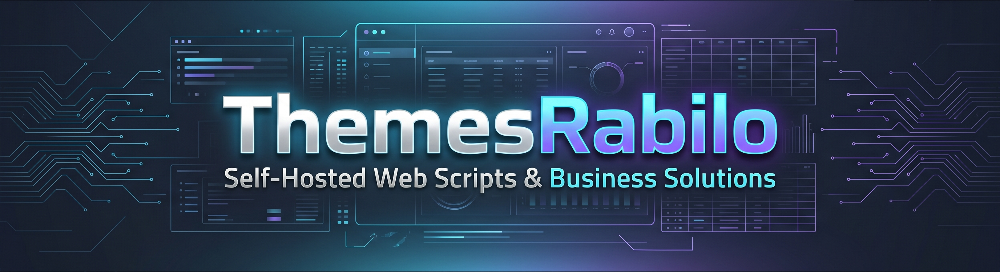

<!-- Banner -->

  

<h1 align="center">ThemesRabilo — Commercial Software & Open Developer Tools</h1>

  <b>Engineering high-performance, turn-key web applications, starter templates, and utility packages to help businesses launch faster and scale effortlessly.</b>

  
  
  

---

### 🚀 About Us
At **ThemesRabilo**, we craft production-grade web applications and client management platforms alongside open-source developer resources. Our GitHub organization serves as the central hub for free utility packages, starter templates, technical documentation, and public issue trackers designed to accelerate real-world product integration.

### ⚡ Our Engineering Standards
* **High Performance:** Engineered for sub-second responses, lightweight assets, and fluid user interactions.
* **Clean Modular Architecture:** Built with SOLID principles, strict type validation, and thorough automated test coverage for seamless customization.
* **Turn-Key & Production-Ready:** Complete commercial applications and starter kits ready for rapid deployment across local, staging, and production environments.
* **Security & Regular Updates:** Continuous product enhancements, vulnerability patching, and long-term compatibility maintenance.

---

### 🌐 Ecosystem & Official Channels

| Channel | Description | Quick Link |
| :--- | :--- | :--- |
| **🏢 Official Hub & Client Portal** | Verify Envato purchase codes, manage licenses, and download official releases. | [themesrabilo.com](https://themesrabilo.com/) |
| **🛒 CodeCanyon Official Store** | Explore our full catalog of commercial scripts, live previews, and verified changelogs. | [Browse Envato Catalog](https://themesrabilo.com/#channels) |
| **📚 Public Solutions & Guides** | Step-by-step installation workflows, server deployment docs, and video walkthroughs. | [Browse Guides](https://themesrabilo.com/#channels) |
| **🎫 Dedicated Support Desk** | Open technical support tickets, pre-sale inquiries, or custom development consultations. | [Contact Support](https://themesrabilo.com/#channels) |

---

### 📦 Featured Open Repositories
*(Tip: Pin your top 4–6 open-source utility packages or starter templates directly below this README so developers can explore them right away.)*

* **Starter Templates:** Boilerplate architectures optimized for rapid web application deployment.
* **Developer Utilities:** Lightweight open-source packages to streamline payment gateway setup, authentication, and API integrations.
* **Documentation & Issue Trackers:** Transparent changelogs, feature requests, and community troubleshooting.

---

### 🤝 Community & Support
* **Need technical assistance or license verification?** Visit the [ThemesRabilo Client Portal](https://themesrabilo.com/) for 1-click Google/Envato sign-in and priority ticket support.
* **Pre-sale or custom inquiries?** Reach out directly through our [Channels Hub](https://themesrabilo.com/#channels).
* If our open-source packages or starter templates help speed up your workflow, consider giving our repositories a **⭐ Star**!
